<div align="center">


# squadai

**A self-hosted office of AI agent teams that work with you, not instead of you.**

Hire a ready-made team, ask for something in plain language, watch the agents work it out in the team's room, and approve the result.


[Features](#features) · [Architecture](#architecture) · [Engineering decisions](#engineering-decisions) · [Quick start](#quick-start) · [Case study](examples/pedal-co/README.md) · [Docs](#documentation)

[](https://render.com/deploy?repo=https://github.com/dcalds99x/squadai)

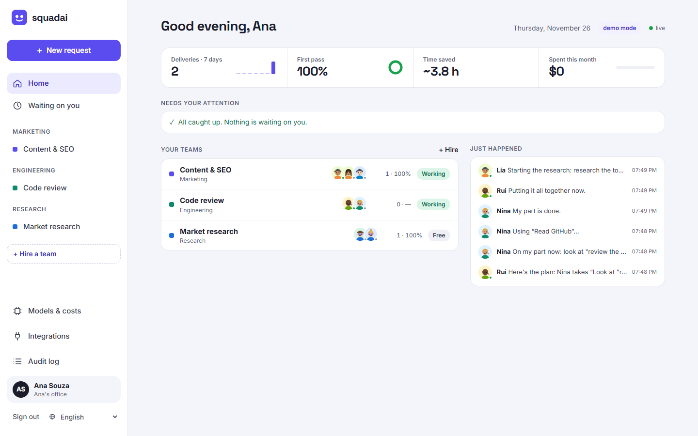

</div>

## What it is

Most AI tools are one chatbot with one prompt. Real work is done by small teams with clear roles: someone researches, someone writes, someone reviews, and a person signs off.

squadai models that. An **office** has **departments** and **teams**. Each team has **agents** with a name, a face, a role, a model ("brain") and permissions. It also has **playbooks**: the things it knows how to deliver. You make a **request**; the agents coordinate in the team's **room** and produce a **delivery** with versions and review notes. **Nothing is final until you approve it.**

It is built the way you would ship software into a customer's environment:

|                           |                                                                                                                                                                                         |
| ------------------------- | --------------------------------------------------------------------------------------------------------------------------------------------------------------------------------------- |
| **Runs anywhere**         | One `docker compose up`. Postgres is the only stateful dependency, and it also holds the job queue and the live events.                                                                 |
| **Bring your own models** | Anthropic (official SDK), OpenAI, Google, OpenRouter, Ollama or any OpenAI-compatible API, with a fallback model per agent. A built-in demo model runs the whole product without a key. |
| **Safe by default**       | Provider keys and integration tokens encrypted at rest (AES-256-GCM). Each tool is _allow_, _ask first_ or _deny_ per agent. Human approval before delivery. Audit log.                 |
| **Durable**               | Every step is checkpointed. Runs survive restarts, wait hours for a person or another team, and resume exactly where they stopped.                                                      |
| **Measurable**            | A cost ledger for every model call, budgets that stop spending, and metrics a manager understands: first-pass approval rate, time saved, spend.                                         |
| **Extensible**            | Teams are YAML files validated in CI. Integrations are any MCP server. Two languages, typed end to end.                                                                                 |

## Features

<table>
<tr>
<td width="50%">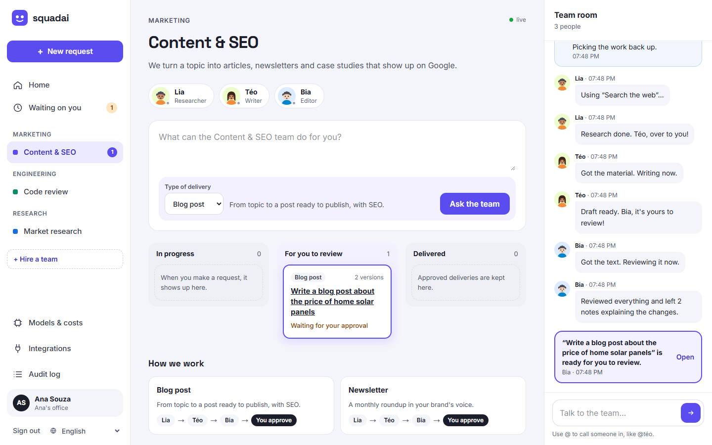</td>
<td width="50%">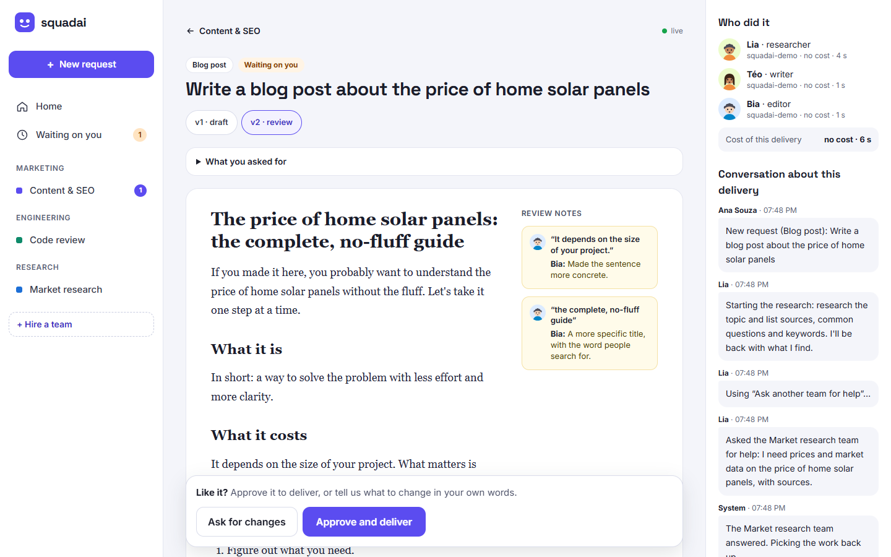</td>
</tr>
<tr>
<td><b>Teams work in the open.</b> The board shows what is in progress, waiting for you or delivered. The room beside it updates live as agents research, write, review and hand work to each other.</td>
<td><b>Deliveries, not chat logs.</b> Every version is kept, the reviewer leaves margin notes, and you see who did what, on which model, and what it cost. Approve it, or ask for changes in your own words.</td>
</tr>
<tr>
<td>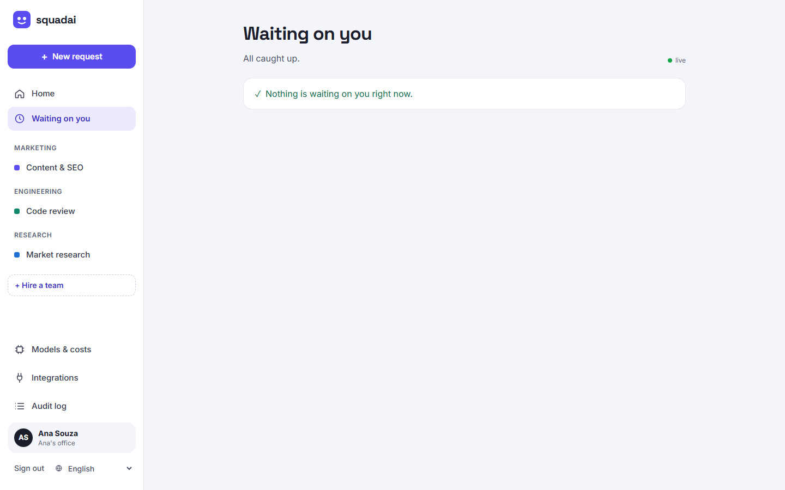</td>
<td>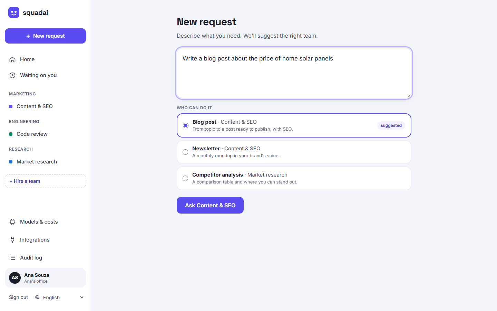</td>
</tr>
<tr>
<td><b>Permissions that pause the work.</b> When a tool is set to “ask first”, the agent stops and asks. You see exactly what it wants to do and allow it or not. The run picks up from there.</td>
<td><b>Just say what you need.</b> The router suggests the right team and playbook as you type. It uses a keyword score and, when a real model is connected, a quick re-rank.</td>
</tr>
<tr>
<td>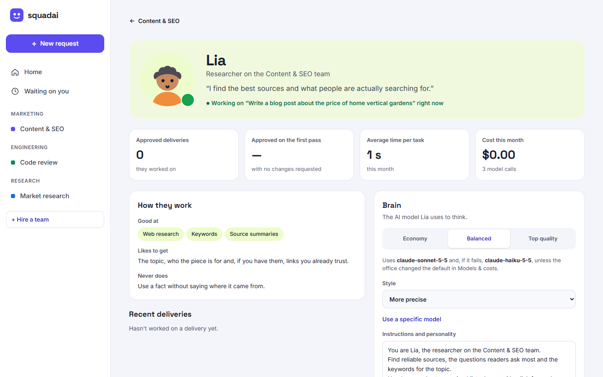</td>
<td>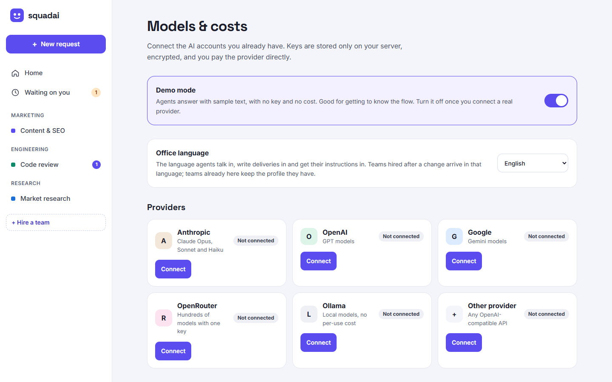</td>
</tr>
<tr>
<td><b>Agents with a personality.</b> Each agent has a bio, a “brain” (model and fallback), a style and permissions per tool, plus its own numbers: first-pass rate, time and cost.</td>
<td><b>Models and costs in one place.</b> Connect providers (keys are tested before saving), map quality profiles to models, set a monthly budget and see spending per team.</td>
</tr>
</table>

More screens: [hiring a team](docs/images/hire.png) · [integrations](docs/images/integrations.png) · [audit log](docs/images/audit.png) · [sign in](docs/images/sign-in.png). Every image is regenerated by [`pnpm screenshots`](scripts/screenshots.ts), which drives a real browser through the product.

## Architecture

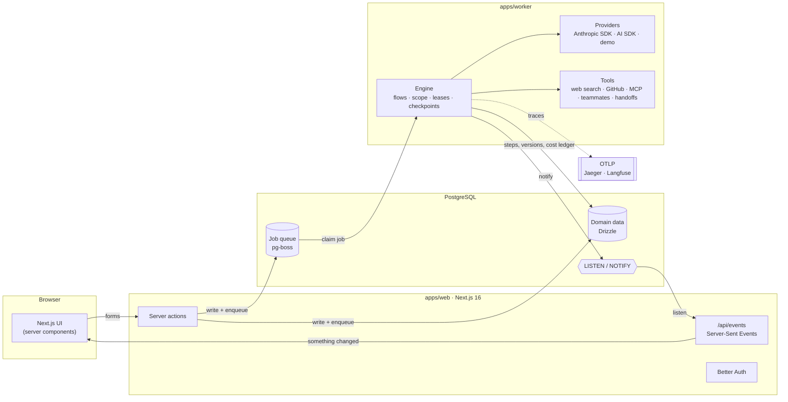

### How a team works a request

A team doesn't run one fixed pipeline. Each delivery type is a small flow, and for a request in plain words the team lead writes the flow on the spot:

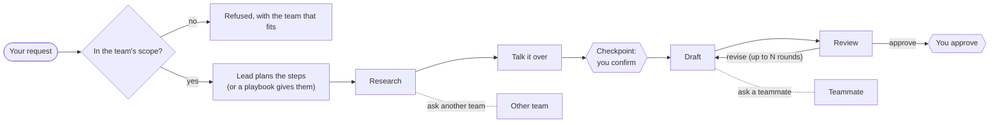

- **Why a separate worker?** A run takes minutes, can wait hours for a person and must survive restarts. None of that belongs in an HTTP request.
- **Why only Postgres?** It is the easiest thing to operate inside someone else's infrastructure. It holds the data, the queue ([pg-boss](https://github.com/timgit/pg-boss), with `SKIP LOCKED`) and the live updates (`NOTIFY`). One backup covers everything. ([ADR-0002](docs/adr/0002-postgres-for-queue-and-realtime.md))
- **Events carry no content.** They only say _what changed_; the browser re-renders through the normal, permission-checked server path.

### Life of a request

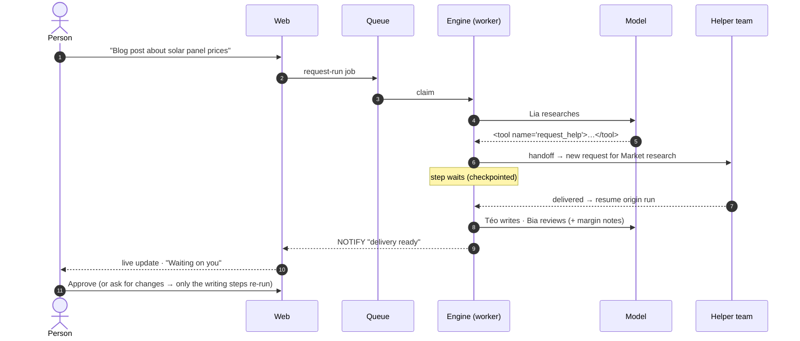

### Orchestration modes

| Mode            | How the steps run                                                          | Example                                                   |
| --------------- | -------------------------------------------------------------------------- | --------------------------------------------------------- |
| **sequential**  | research → draft → review; each step gets the previous output              | Content & SEO: Lia → Téo → Bia                            |
| **coordinator** | the lead writes a JSON plan, teammates work in parallel, the lead combines | Code review: Rui plans, Nina checks tests, Rui summarizes |
| **parallel**    | every step but the last runs at once; the last one combines                | Competitor analysis: two angles, then a synthesis         |

### Durable steps

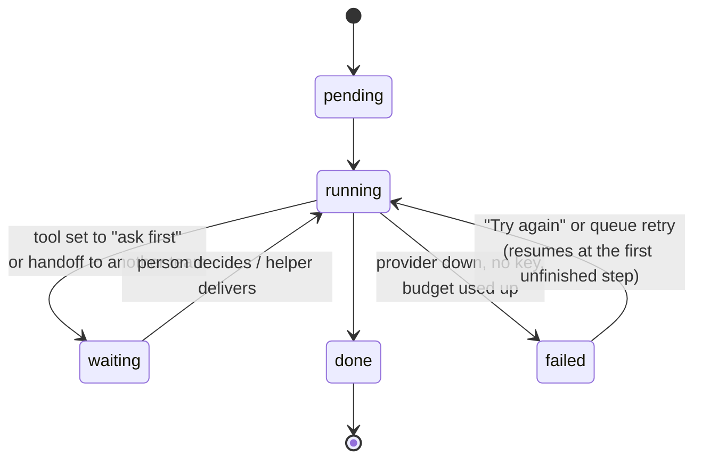

The conversation so far and what the step waits for live in `step.checkpoint`. Any worker can pick a run back up after a crash or a deploy.

### Data model

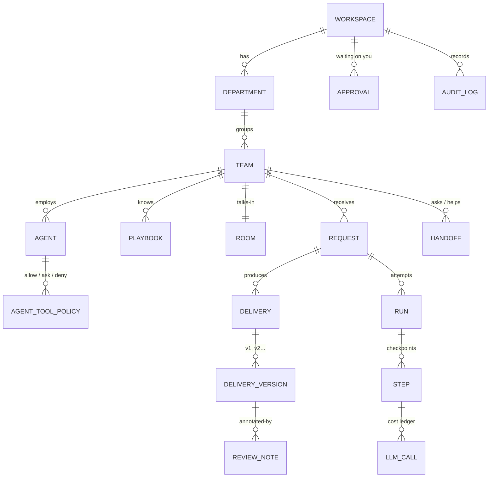

## Engineering decisions

Every decision that is hard to reverse has an [architecture decision record](docs/adr):

| ADR                                                      | Decision                                                                                    |
| -------------------------------------------------------- | ------------------------------------------------------------------------------------------- |
| [0001](docs/adr/0001-monorepo.md)                        | pnpm + Turborepo monorepo: apps and shared packages change together                         |
| [0002](docs/adr/0002-postgres-for-queue-and-realtime.md) | Postgres for data, the job queue and realtime: one service to operate                       |
| [0003](docs/adr/0003-teams-as-code.md)                   | Team templates as YAML, validated by Zod and compiled to TypeScript in CI                   |
| [0004](docs/adr/0004-typescript-source-packages.md)      | Packages ship TypeScript source; the worker runs on Node's type stripping, no build step    |
| [0005](docs/adr/0005-better-auth.md)                     | Better Auth, self-hosted, with a path to SSO                                                |
| [0006](docs/adr/0006-secrets-at-rest.md)                 | AES-256-GCM for keys at rest, with a versioned format ready for KMS                         |
| [0007](docs/adr/0007-model-providers.md)                 | Official Anthropic SDK for Claude, AI SDK for the rest, a deterministic demo model          |
| [0008](docs/adr/0008-text-tool-protocol.md)              | A text protocol for tool calls: works with every provider and serializes for durable pauses |
| [0009](docs/adr/0009-internationalization.md)            | Two locales with separate owners (person vs. office), typed message catalogs                |

A few things worth pointing out:

- **Honest metrics.** Every dashboard number has a written, unit-tested definition ([`metrics.ts`](packages/core/src/metrics.ts)). With no data, a metric shows “—” instead of a misleading zero.
- **Errors people can act on.** Failures become messages like “Connect Anthropic under Models & costs”, never stack traces, and the run can be resumed.
- **Least privilege for agents.** Tools from new integrations start as _deny_. _Ask first_ is enforced by the engine, not by the prompt.
- **Typed all the way.** Strict TypeScript, Zod at every boundary (env, forms, templates), and i18n keys checked by the compiler.

## Quality

| Check                                                                                                                                    | Where                                                         |
| ---------------------------------------------------------------------------------------------------------------------------------------- | ------------------------------------------------------------- |
| Biome lint + format                                                                                                                      | `pnpm lint`                                                   |
| Strict TypeScript across every package                                                                                                   | `pnpm typecheck`                                              |
| Unit tests: metrics, crypto, avatars, protocol parsing, routing, catalogs, i18n parity                                                   | `pnpm test`                                                   |
| Integration tests on a real Postgres with the demo model: every orchestration mode, tool pauses, handoffs, budgets, resume after failure | `pnpm test` with `DATABASE_URL`                               |
| Team templates and migrations up to date                                                                                                 | `pnpm catalog:check`, `drizzle-kit check`                     |
| Production build and Docker images                                                                                                       | CI ([`.github/workflows/ci.yml`](.github/workflows/ci.yml))   |
| No double runs under load; resume after the worker is killed mid-run                                                                     | `pnpm test`, `load-test` ([reliability](docs/reliability.md)) |
| Team evals: reference requests per team, rule checks in CI, AI judge on `main`                                                           | `pnpm evals`                                                  |
| End-to-end browser tests: sign-up → request → approval → checkpoint → permission                                                         | `pnpm e2e`                                                    |
| OpenTelemetry traces for every run, step, tool and model call                                                                            | Jaeger (`--profile tracing`) or Langfuse                      |

## Tech stack

| Layer             | Choice                                                                             |
| ----------------- | ---------------------------------------------------------------------------------- |
| Web               | Next.js 16 (App Router, server actions), React 19, Tailwind CSS v4, next-intl      |
| Auth              | Better Auth (email + GitHub), Drizzle adapter                                      |
| Data              | PostgreSQL 17, Drizzle ORM, SQL migrations                                         |
| Jobs and realtime | pg-boss, Postgres `LISTEN/NOTIFY`, Server-Sent Events                              |
| Models            | `@anthropic-ai/sdk`, Vercel AI SDK (OpenAI, Google, OpenAI-compatible), demo model |
| Tools             | Claude web search, GitHub REST, Notion API, MCP (`@modelcontextprotocol/sdk`)      |
| Tooling           | pnpm, Turborepo, Biome, Vitest, Playwright (screenshots), Docker, GitHub Actions   |

## Quick start

Requirements: Docker. For development: Node 24+ and pnpm 10.

```bash
git clone https://github.com/dcalds99x/squadai.git
cd squadai
cp .env.example .env
# Set BETTER_AUTH_SECRET and SQUADAI_MASTER_KEY (the commands are in the file)
docker compose up --build
```

Open http://localhost:3000 and create an account: Lia, Téo and Bia are already in your office. Turn on **demo mode** under _Models & costs_ to try everything without an API key, or connect a provider.

### Development

```bash
pnpm install
pnpm db:up && pnpm db:migrate   # Postgres in Docker
pnpm dev                        # web on :3000 + worker
```

| Command                     | What it does                                                           |
| --------------------------- | ---------------------------------------------------------------------- |
| `pnpm lint` / `pnpm format` | Biome lint and format                                                  |
| `pnpm typecheck`            | TypeScript across the monorepo                                         |
| `pnpm test`                 | Unit tests, plus Postgres integration tests when `DATABASE_URL` is set |
| `pnpm catalog:generate`     | Validate team templates and their translations, regenerate the catalog |
| `pnpm db:generate`          | Create a migration after changing the schema                           |
| `pnpm screenshots`          | Drive a real browser through the app and refresh `docs/images`         |

### Languages

The interface speaks **English** and **Brazilian Portuguese**. Each person picks their own; agents work in the office's language. Catalog content (team, role and playbook names) follows the reader. Anything people or agents wrote stays as written. See [ADR-0009](docs/adr/0009-internationalization.md).

## Repository layout

```
apps/
  web/         Next.js app: UI, auth, server actions, SSE, health check
  worker/      pg-boss worker: runs requests, room replies, schedules; load test
packages/
  core/        Domain vocabulary, metrics, avatars, locales, secret encryption
  engine/      Orchestration: flows, scope, leases, tool loop, pauses, handoffs, tracing
  evals/       Reference requests per team, rule checks and an AI judge
  providers/   Model adapters, pricing, tool protocol, demo model
  catalog/     Team templates (YAML), schema, translations
  db/          Drizzle schema, migrations, read models
  ui/          Aurora design system components
e2e/           Playwright end-to-end tests
examples/      Pedal & Co. case study: custom team and an orders MCP server
docs/          PRD, architecture, reliability, ADRs, team guide, screenshots
scripts/       Screenshot automation
```

## Roadmap

| Phase           | Scope                                                                                 | Status |
| --------------- | ------------------------------------------------------------------------------------- | ------ |
| 0. Foundation   | Monorepo, CI, Docker, schema, auth, design system                                     | ✅     |
| 1. Core loop    | Providers, requests, live room, versioned deliveries, approvals                       | ✅     |
| 2. Real teams   | Coordinator/parallel modes, handoffs, router, budgets, fallback models                | ✅     |
| 3. Integrations | Tools, MCP, GitHub, Notion, enforced permissions, audit log                           | ✅     |
| 3.5 Feedback    | Model picker, free-form requests, team scope, fluid flows (loops, talks, checkpoints) | ✅     |
| 4. Reliability  | Evals in CI, OpenTelemetry traces, crash-resume test, load tests, Playwright E2E      | ✅     |
| 5. Showcase     | Public demo, deployment case study, video                                             | next   |

## Documentation

- [Product requirements](docs/prd.md): goals, requirements and a log of every scope change
- [Architecture](docs/architecture.md): how the pieces fit, metric definitions, security
- [Reliability](docs/reliability.md): no double runs, crash recovery, tracing, evals, E2E and load tests
- [Case study: Pedal & Co.](examples/pedal-co/README.md): a fictional client deployment, with a custom team and an MCP connector
- **Public demo:** [`render.yaml`](render.yaml) deploys web, worker and Postgres with `SQUADAI_PUBLIC_DEMO=1` (demo model, sample work, no keys or integrations)
- [Architecture decision records](docs/adr)
- [Creating a team](docs/teams.md)
- [Contributing](CONTRIBUTING.md), including how to add a language

## License

[MIT](LICENSE)
