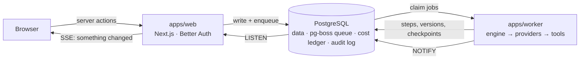

# Architecture

## The product in one paragraph

A **workspace** is an office. It has **departments** (Marketing, Desenvolvimento…) and each department has **teams**. A team has **agents** (people-like personas with a model, a fallback model and tool permissions) and **playbooks**: the things it knows how to deliver. A person makes a **request**. The team carries it out in its **room**, where agents post as they work, and produces a **delivery** with versions and review notes. The person approves it or asks for changes. A team can ask another team for help with a **handoff**.

## System overview



**Why a separate worker?** An agent run takes minutes, pauses for human approval and must survive restarts. None of that fits inside an HTTP request.

**Why Postgres for everything?** One stateful service is the easiest thing to run inside a customer's infrastructure. See [ADR-0002](adr/0002-postgres-for-queue-and-realtime.md).

## Data model

| Area       | Tables                                                                                       |
| ---------- | -------------------------------------------------------------------------------------------- |
| Identity   | `user`, `session`, `account`, `verification` (Better Auth), `workspace`, `membership`        |
| Office     | `department`, `team`, `agent`, `agent_tool_policy`, `playbook`, `room`, `message`, `handoff` |
| Work       | `request`, `delivery`, `delivery_version`, `review_note`, `run`, `step`, `approval`          |
| Operations | `provider_credential`, `llm_call`, `budget`, `audit_log`                                     |

The schema is in [`packages/db/src/schema`](../packages/db/src/schema). Everything is scoped by `workspace_id` and deleted with the workspace (`ON DELETE CASCADE`).

## Orchestration (Phase 1–2)

A playbook has a `mode` and ordered `steps`:

- **sequential**: each step receives the previous step's output.
- **coordinator**: the first agent plans and delegates to the others through tools.
- **parallel**: every step but the last runs at once; the last combines the results.

Each step is written to the `step` table before and after it runs, with a checkpoint. A run that waits for approval just sits in `waiting` state. Any worker can pick it up later. Agents coordinate by posting to the team room, so what people see is exactly what happened.

**Implemented in Phase 1** (`packages/engine`):

- Every playbook runs its steps in order. In a playbook with more than one step, the first step is research and its output is passed along without becoming a version. Each later step writes a new `delivery_version`. When there are three or more steps, the last one is a review: the reviewer returns the revised text plus margin notes, which become `review_note` rows.
- **Asking for changes** re-runs only the steps that produce versions, giving them the person's feedback and the current text. `delivery.adjustment_count` goes up by one, which feeds "Approved on the first pass".
- **Resume:** if a step fails (provider down, key missing, crash), the run is marked `failed` with a message a person can act on. "Try again", or a pg-boss retry, continues from the first step that isn't done.
- **Room replies:** mentioning `@agent` in the room queues a `room-reply` job, and the agent answers in character.
- **Fallback model:** every call goes through `generateWithFallback`. It tries the agent's primary model, then its Plan B, and records which one answered.

### Flows (added 2026-11-27)

A sequential playbook is a **flow**: each step has a `kind` (`research`, `draft`, `review`, `discuss` or `checkpoint`). Steps without a kind follow the position rule above, so older playbooks run exactly as before. The interpreter lives in `runRequest`; the pure helpers in `packages/engine/src/flow.ts`.

- **review** with `rounds` > 1: the reviewer starts with `VERDICT: approve` or `VERDICT: revise` (a protocol token). On `revise`, its notes go back to the last writer, who rewrites, and the reviewer looks again, up to `rounds` times. The last round always approves with a revised text and notes.
- **discuss**: the step's agent and its `with` teammates each post a short view in the room, seeing what was said before. The agent then sums up, and the summary feeds the next steps as "what the team agreed".
- **checkpoint**: no model call. The engine creates an `approval` (`kind = "checkpoint"`) and the run waits. "Go on" resumes it; "Stop here" ends the request as `cancelled`.
- **Free-form requests** (no playbook): the team lead (`team.lead_key`, else the first agent) writes the flow as JSON (`{"fit","title","steps":[{"agent","kind","task","with","rounds"}]}`). `parseFlowPlan` drops unknown agents and invalid steps, and adds a draft by the lead if nothing writes. The plan is stored in `request.flow`, so a revision follows the same flow without planning again, and the delivery is named after its `title`. If the lead answers `{"fit":"out"}`, the run ends as `declined` and the room says which team fits better.
- **ask_teammate**: inside any step an agent can ask a teammate a quick question. The teammate answers on the spot with its own model, and both lines show in the room.

Every step gets its position from a counter in execution order, and every decision (verdicts, plans, approvals) is stored in a step's output. So a run that resumes after a pause or a crash replays to exactly the same position.

### Scope

Each team has a `scope` (`does` and `doesNot` lists, from its template). `checkScope` runs before a request is created: a keyword score with strict 6-letter stems, then, when a real model is connected, a cheap model with the last word. A request outside the scope is not created; the form offers to send it to the team (and agent) that fits better. Every agent prompt, including room replies, also carries the scope and the other teams' names.

**Coordinator mode:** the lead agent writes a plan as JSON (`{"tasks":[{"agent","task"}]}`). Each teammate gets its own step, all of them running at the same time. Then the lead combines their work into a version. If the plan cannot be parsed, the playbook's own steps are used instead. **Parallel mode:** every step but the last runs at the same time, and the last one combines the results. When a person asks for changes in either mode, only the combining step runs again, using the earlier contributions.

Before every model call, the engine:

1. resolves the agent's model: its own override, else the workspace's tier model, else the default;
2. calls the model, and on a provider error retries with the fallback model;
3. writes an `llm_call` row with tokens, cost and latency.

Before every model call the engine also checks the monthly budget (`checkBudget`). When it is used up, the run stops with a message that says how to fix it. Every run, step, tool and model call is an OpenTelemetry span; see [reliability.md](reliability.md#tracing).

## Live updates

The worker writes to Postgres and then sends `NOTIFY squadai_events` with a small event saying what changed (`room`, `request`, `presence` or `delivery`, plus IDs), never the content itself. Each web server process holds one `LISTEN` connection and streams events over Server-Sent Events (`/api/events`) to the browser tabs of the same workspace. The page then calls `router.refresh()`, so the data always comes back through the normal, permission-checked server render.

## Models

- **Anthropic** goes through the official `@anthropic-ai/sdk`. Current Claude models take no sampling parameters, so the agent's style goes into the system prompt and its tier sets `effort` (economy → `low`, balanced → `medium`, max → `high`). Opus 5.5 and Sonnet 5.5 send the server-side refusal fallback (`fallbacks: "default"`).
- **OpenAI, Google, OpenRouter, Ollama and any OpenAI-compatible API** go through the Vercel AI SDK.
- **Demo model:** deterministic, free and offline. It turns on per workspace with "Demo mode", so anyone can try the full flow without an API key, and the engine's integration tests use it.
- **Prices** live in `packages/providers/src/pricing.ts`, in US dollars per million tokens. Models without a known price are recorded at cost 0 and still count tokens.

## Tools, permissions and handoffs

Agents call tools through a text protocol that works with every provider ([ADR-0008](adr/0008-text-tool-protocol.md)):

```
<tool name="web_search">{"query": "home solar panel prices"}</tool>
```

| Tool                  | What it does                                                                            | Default policy |
| --------------------- | --------------------------------------------------------------------------------------- | -------------- |
| `web_search`          | Claude's server-side web search, returning sources. Answers from examples in demo mode. | allow          |
| `github_read`         | Reads a pull request: description and diff                                              | allow          |
| `github_comment`      | Comments on a pull request. Needs the GitHub integration.                               | ask            |
| `request_help`        | Asks another team for help and waits for the answer                                     | allow          |
| `ask_teammate`        | Asks someone on the same team a quick question and gets the answer right away           | allow          |
| `mcp.<server>.<tool>` | Every tool of a connected MCP server                                                    | deny           |

Each agent has a policy for each tool:

- **allow:** the tool runs right away.
- **ask:** the step pauses. The engine creates an `approval` row (`kind = "tool"`, with the input) and the step checkpoint records what it is waiting for. When a person decides in "Waiting on you", the run resumes. If the tool was allowed, it runs and the agent gets the result. If not, the agent is told and carries on without it.
- **deny:** the tool is never shown to the model.

**Handoffs:** `request_help` creates a normal request on the other team, using its first playbook that needs no approval, plus a `handoff` row. The asking step waits. When the helper's delivery is done, `resolveHandoffsFor` stores the answer and returns the origin request to resume. The same thing happens when a person approves a helper delivery that needed approval. Both rooms show the exchange.

**Router:** "New request" ranks every playbook with a keyword score that knows a few synonyms. When a real model is connected and the top results are close, a cheap model re-ranks them.

## Languages

squadai speaks `pt-BR` and `en` ([ADR-0009](adr/0009-internationalization.md)). Two locales decide which:

- **The person's locale** (cookie, then `Accept-Language`, then `pt-BR`) for the interface. `apps/web` uses next-intl with typed JSON catalogs in `apps/web/messages`.
- **The workspace locale** (`WorkspaceSettings.locale`, set from the person who created the office) for everything agents write and read: room lines, prompts, tool descriptions, demo output, provider errors and the teams it hires. Each package keeps those words in a typed catalog next to its code.

Protocol tokens (tool tags, tool input keys, the review marker and the plan's JSON keys) are the same in every locale.

## Metrics

The definitions live in [`packages/core/src/metrics.ts`](../packages/core/src/metrics.ts) and are unit tested:

| Metric               | Definition                                                                         |
| -------------------- | ---------------------------------------------------------------------------------- |
| Delivered this week  | Deliveries approved since Monday 00:00 UTC                                         |
| First-pass approvals | This week's deliveries approved with zero change requests ÷ this week's deliveries |
| Waiting on you       | Pending approvals, plus the age of the oldest                                      |
| Time saved           | Sum of each delivered playbook's `estimatedHumanMinutes`                           |
| Spent this month     | Sum of `llm_call.cost_micros` this month, against `budget.monthly_limit_cents`     |

When there is no data yet, a metric shows "—" and says when it will appear, rather than a misleading zero.

## Security

- Provider API keys are encrypted with AES-256-GCM using `SQUADAI_MASTER_KEY` ([ADR-0006](adr/0006-secrets-at-rest.md)). Only the last four characters are ever shown.
- Tools are denied unless a policy allows them. "Ask first" turns a tool call into an approval.
- Every state change that matters writes to `audit_log`.

## Roadmap

| Phase           | Scope                                                                                                                                  | Status                   |
| --------------- | -------------------------------------------------------------------------------------------------------------------------------------- | ------------------------ |
| 0. Foundation   | Monorepo, CI, Docker, schema, auth, Aurora shell, team catalog, worker                                                                 | ✅                       |
| 1. Core loop    | Provider setup with encrypted keys, hire a team, agent profile, sequential playbooks, deliveries with versions and approval, live room | ✅                       |
| 2. Real teams   | Coordinator and parallel modes, handoffs between teams, request router, live metrics, budgets, fallback models                         | ✅                       |
| 3. Integrations | MCP tools (web search, GitHub, Notion, Google Docs), enforced permissions, audit views                                                 | ✅ (Google Docs pending) |
| 4. Reliability  | Evals in CI, OpenTelemetry traces, resume after crash, load tests                                                                      |                          |
| 5. Showcase     | Public demo, deployment case study, video                                                                                              |                          |
